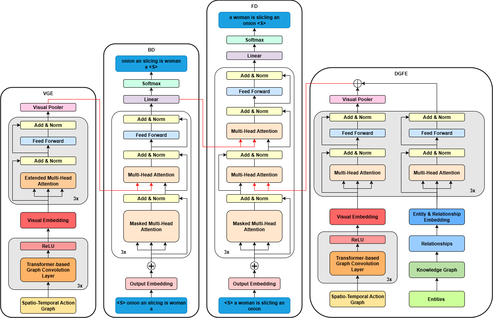

# KGSTAG: Knowledge-Guided Spatio-Temporal Action Graphs for Video Captioning

Official implementation of **Knowledge-Guided Spatio-Temporal Action Graphs for Video Captioning** (KGSTAG).

KGSTAG is a dual-graph fusion framework built on a bidirectional Transformer:

- a **Spatio-Temporal Action Graph** represents each sampled frame as a 3 × 3 grid of patch nodes (CLIP-ViT features) and encodes motion as multi-dimensional action edges (I3D features) plus cosine-similarity temporal edges between consecutive frames, encoded by a Graph Transformer (TransformerConv) followed by a temporal Transformer (Visual Graph Encoder, VGE);
- a **Knowledge Graph** built from the training captions is queried with CLIP-ViT frame embeddings (detector-free entity retrieval), and the retrieved entities and relations are encoded by a Semantic Graph Encoder (SGE);
- the two representations are fused by the Dual-Graph Fusion Encoder (DGFE) and decoded by a **Backward Decoder** (right-to-left, visual memory only) whose hidden states guide a **Forward Decoder** (left-to-right, fused memory).



## Results

Single runs with the configuration of `config.py` (seed 904666), scores of the forward decoder on the test split.

| Dataset | BLEU-4 | METEOR | ROUGE-L | CIDEr |
|---|---|---|---|---|
| MSVD | 64.95 | 42.95 | 79.21 | 121.99 |
| MSR-VTT | 49.60 | 31.12 | 65.39 | 61.34 |

See the paper for the full comparison, the ablation study and the supplementary analyses.

## Repository layout

```
KGSTAG/
├── main.py                 training and evaluation entry point (torchrun)
├── run.py, utils.py        evaluation helpers, training / validation loops, graph mini-batching
├── config.py               all hyperparameters and data paths (ROOT = this folder, or $KGSTAG_ROOT)
├── loader/                 MSVD / MSR-VTT corpora, vocabulary and the fusion data loader
├── model/                  KGSTAG model (Graph Transformer, VGE, SGE, DGFE, bidirectional decoders)
├── STGraph/                feature extraction: CLIP4Clip grid nodes, I3D action edges, temporal edges, graph assembly
├── KG/                     knowledge graph construction (CoreNLP OpenIE) and CLIP-based entity retrieval
├── split/                  splits the extracted features into the train / val / test files read by the loader
└── assets/                 figures
```

## 1. Environment

Tested with Python 3.12, PyTorch 2.6 (CUDA 12.6) and PyTorch Geometric.

```bash
conda create --name kgstag python=3.12 -y
conda activate kgstag
pip install torch==2.6.0 torchvision==0.21.0 torchaudio==2.6.0 --index-url https://download.pytorch.org/whl/cu126
pip install pyg_lib torch_scatter torch_sparse torch_cluster torch_spline_conv -f https://data.pyg.org/whl/torch-2.6.0+cu126.html
pip install -r requirements.txt
```

The caption metrics are computed with `pycocoevalcap`, whose METEOR scorer needs Java on the `PATH`.

## 2. Data

Raw videos and annotations:

- **MSVD**: 1,970 clips, split 1,200 / 100 / 670 (`data/MSVD/metadata/{train,val,test}.csv`, the full corpus file `MSR Video Description Corpus.csv`, the `youtube_mapping.txt` file that maps `vidN` to the YouTube clip name). Raw `.avi` clips go to `Dataset/MSVD/raw`.
- **MSR-VTT**: 10,000 clips, split 6,513 / 497 / 2,990 (`data/MSR-VTT/metadata/{train,val,test,total}.json`). Raw clips go to `Dataset/MSRVTT/videos/all`.

The training code reads pre-extracted features from

```
data/<CORPUS>/features/<CORPUS>_GBased_<phase>.pickle     spatio-temporal action graphs (PyG format)
data/<CORPUS>/features/<CORPUS>_rel_<phase>.hdf5          CLIP text embeddings of the retrieved entities and relations
data/<CORPUS>/features/<CORPUS>_videomask_<phase>.hdf5    frame masks (1 for real frames, 0 for padding)
```

with `<CORPUS>` in `{MSVD, MSR-VTT}` (note the hyphen) and `<phase>` in `{train, val, test}`. The paths are built in `config.py` from `ROOT`, which defaults to the repository folder and can be overridden with the environment variable `KGSTAG_ROOT`.

## 3. Feature extraction

All scripts in `STGraph/` are run from the `STGraph/` folder and are configured by editing the small `args` class (or the path variables) at the top of each file: `msvd = True` for MSVD and `False` for MSR-VTT, and the name of the `extracted/<dataset>` folder.

Before starting:

- copy the `modules/` folder of [CLIP4Clip](https://github.com/ArrowLuo/CLIP4Clip) into `STGraph/modules/` (already included) and fine-tune CLIP4Clip (ViT-B/16, 1 fps, 20 frames) on the target dataset with the splits above; put the resulting checkpoint under `CLIP4Clip/ckpts/ckpt_<msvd|msrvtt>_retrieval_looseType/pytorch_model.bin.4` (path set in `grid_node_feature_extractor.py`);
- download the Kinetics-400 I3D weights `rgb_imagenet.pt` from [pytorch-i3d](https://github.com/piergiaj/pytorch-i3d) into `STGraph/pretrained/`.

Then, for each dataset:

| Step | Script | Output (`STGraph/extracted/<dataset>/`) |
|---|---|---|
| 1. Grid node features: 20 frames at 1 fps, 3 × 3 overlapping patches (overlap 0.5), CLIP4Clip ViT-B/16, 512-d | `grid_node_feature_extractor.py` | `grid_node_features.hdf5` |
| 2. Spatial action graph: I3D (16-frame clips, 1,024-d) features assigned to the frames, fully connected patch pairs per frame | `grid_based_spatial_action_graph.py` | `grid_spatio_graph.hdf5` |
| 3. Temporal edges: softmax-normalised cosine similarity between the patches of consecutive frames | `temporal_similarity_graph.py` | `grid_temporal_graph.hdf5` |
| 4. Spatio-temporal graph: within-frame edges carry the I3D vector, cross-frame edges carry the similarity in the first channel | `action_spatio_temporal_graph_feature_extractor.py` | `stg.hdf5` |
| 5. Conversion to PyTorch Geometric objects (x, edge_index, sparse edge_attr) | `transform-graph-to-geometric.py` | `stg.pickle` |

A 20-frame video gives a graph with 180 nodes and 3,159 directed edges (1,620 within-frame edges including self-loops and 1,539 cross-frame edges).

## 4. Knowledge graph

1. **Construction** (`KG/extract_triplets.ipynb`): the training captions are parsed with Stanford CoreNLP 4.5.4 OpenIE (tokenize, lemma, POS, depparse, natlog, openie with strict triples and one entailment per clause). Head and tail entities are lemmatised noun tokens, relations are lemmatised verb tokens; stop-words, quantifiers and auxiliary relations are removed, the head and the relation are limited to two dictionary words and duplicate triples are dropped. The result is written to `KG/<dataset>_filtered_entities.txt` (one `head &tail &relation` per line). The graphs used in the paper contain 13,849 triples, 4,773 entities and 897 relation types for MSVD, and 27,931 triples, 12,875 entities and 1,293 relation types for MSR-VTT.
2. **Retrieval and embedding** (`KG/retrieve_kg.py`): every entity label is encoded with the CLIP text encoder of the fine-tuned CLIP4Clip model, every video is sampled at 1 fps (20 frames) and encoded with the CLIP image encoder, the top-k entities by cosine similarity (k = 10) form the retrieved entity set, the relations whose two endpoints are retrieved form the relation set, and the k entity strings and the relation strings are encoded with the CLIP text encoder and stored as a (k + |R|) × 512 matrix per video.

```bash
python KG/retrieve_kg.py --dataset MSVD --videos Dataset/MSVD/raw --triples KG/msvd_filtered_entities.txt \
    --mapping data/MSVD/captions/youtube_mapping.txt --clip4clip CLIP4Clip/ckpts/ckpt_msvd_retrieval_looseType/pytorch_model.bin.4 \
    --k 10 --out KG/msvd_rel_all.hdf5
```

`STGraph/clip_embedding.ipynb` contains the original text-embedding cell; `retrieve_kg.py` is the scripted form of the retrieval step described in the paper (Eqs. 10 to 12).

## 5. Splitting the features

```bash
python split/split_features.py --dataset MSVD --root . \
    --stg STGraph/extracted/msvd/stg.pickle --vidmask STGraph/extracted/msvd/vid_mask.hdf5 --rel KG/msvd_rel_all.hdf5
python split/split_features.py --dataset MSR-VTT --root . \
    --stg STGraph/extracted/msrvtt_grid/stg.pickle --vidmask STGraph/extracted/msrvtt_grid/video_mask.hdf5 --rel KG/msrvtt_rel_all.hdf5
```

MSVD is split with `data/MSVD/metadata/{train,val,test}.list` and `youtube_mapping.txt`; MSR-VTT is split by video number (video0 to video6512 train, video6513 to video7009 val, video7010 to video9999 test). The MSVD graph pickle is about 37 GB on disk; use `--stg_lowmem` on machines with little RAM.

## 6. Training and evaluation

```bash
N_GPU=2
MODE=MSVD_GBased+rel+videomask        # or MSR-VTT_GBased+rel+videomask
OMP_NUM_THREADS=8 torchrun --nproc_per_node=$N_GPU --master_port=12345 main.py --model_name $MODE --attention 1 --do_train
```

- `--model_name`: `<CORPUS>_GBased+rel+videomask` is the full model; `<CORPUS>_GBased+videomask` trains the variant without the knowledge graph.
- `--attention 1` (default) encodes the retrieved entities and relations with multi-head self-attention without positional encoding, as in the paper; `2` adds positional encoding and `3` uses a feed-forward encoder (the two variants of the SGE ablation).
- `--seed`: random seed (904666 for the runs in the paper).
- `--legacy_batching`: see the note below.

Training logs go to `logs/<CORPUS>/<run id>` (TensorBoard), checkpoints to `checkpoints/<CORPUS>/<run id>/<epoch>.ckpt` and the validation scores of every epoch to `log.txt`. After training, `main.py` evaluates the saved checkpoints on the test split, writes the generated captions to `captioning/<CORPUS>/<run id>/<epoch>.csv` and the scores to `result/<run id>.txt`. Running `main.py` without `--do_train` only performs this evaluation step on the checkpoints found in `checkpoints/<CORPUS>/<run id>`.

Hyperparameters (all in `config.py`):

| Parameter | Value |
|---|---|
| Sampled frames T, frames per I3D clip | 20, 16 |
| Grid G × G, patch overlap | 3 × 3 (9 patches), 0.5 |
| Node / action / graph / model dimension | 512 / 1,024 / 1,024 / 640 |
| Graph Transformer | 3 TransformerConv layers, 4 heads, mean aggregation, gated residual |
| Temporal Transformer of VGE_B / VGE_F | hidden 768, 3 layers, 128 / 12 heads |
| SGE | 3 layers, 10 heads, no positional encoding, input resampled to T = 20 tokens |
| Decoders | BD 3 layers × 3 sub-layers, FD 3 layers × 4 sub-layers, 10 heads |
| Retrieved entities k | 10 |
| Loss weight λ | 0.6 |
| Optimizer | AdamW, lr 1e-4, weight decay 5e-6, 10% linear warm-up then linear decay, gradient clipping 5.0 |
| Batch | 32 per GPU, gradient accumulation 1 (MSVD) / 2 (MSR-VTT) on 2 GPUs (effective 64 / 128) |
| Label smoothing, epochs | 0.15, 30 (MSVD) / 25 (MSR-VTT) |
| Decoding | beam width 5, maximum 20 tokens |

A run takes about 7.5 h for MSVD and 18 h for MSR-VTT on two NVIDIA RTX 3090 GPUs. The MSVD training features need about 26 GB of host memory per process.

### Note on graph mini-batching

`utils.graph_batch_offset` builds the edge indices of a mini-batch by offsetting the edges of the i-th graph by `n_node * i`. The experiments reported in the paper were run with the offset inherited from the AKVA code base (`int(sqrt(n_edges)) * i`), which assigns the edges of a batch to the first graphs only; inference processes one video at a time and is not affected. The flag `--legacy_batching` restores that behaviour so that the reported runs can be reproduced exactly; without the flag every graph of a batch receives its own edges during training.

## Acknowledgements

This implementation builds on the public code of AKVA (Hendria et al., 2023), BiTransformer / BTKG (Zhong et al., 2022, 2024), [CLIP4Clip](https://github.com/ArrowLuo/CLIP4Clip), [pytorch-i3d](https://github.com/piergiaj/pytorch-i3d) and [PyTorch Geometric](https://github.com/pyg-team/pytorch_geometric).

## Citation

```bibtex
@article{kgstag2026,
  title   = {Knowledge-Guided Spatio-Temporal Action Graphs for Video Captioning},
  author  = {TODO: author list},
  journal = {TODO: journal (under review)},
  year    = {2026}
}
```
